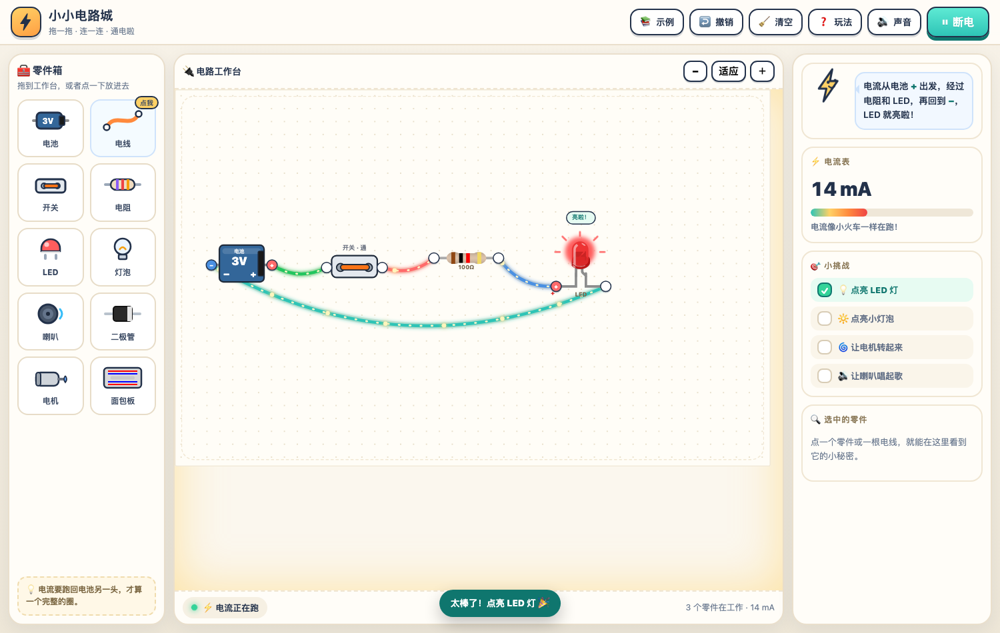

# 小小电路城 ⚡



给 5 岁小朋友的网页电路模拟实验室：把电池、按钮、开关、电阻、可变电阻、LED、灯泡、喇叭、二极管、保险丝、电机、电流表、电压表、面包板拖到工作台上，用小圆点连电线，按「通电试试」就能看到电流在电线里流动。零件用的是**真实参数**：二极管有 0.7V 压降、LED 按颜色有 1.8～2.6V 正向电压、电池有 0.18Ω 内阻，每个零件都有**额定电流/额定功率**——超了会发烫，然后💨烧坏（点它就能「换一个新的」），保险丝则会「啪」地熔断来保护电路。电路短路时，会「砰」地爆炸一下，提醒小朋友：电线不能直接连电池两头。点一点零件，还会用中文告诉小朋友它是做什么的，并用中文读出来（语音朗读）。

## 怎么打开

- 方式一（推荐）：在线玩 **<https://xiaohe4966.github.io/xiaoxiao-dianlucheng/>** —— 手机、平板、电脑打开就能玩，不需要安装任何东西。
- 方式二：直接双击 `index.html`，用浏览器打开即可（完全离线）。
- 方式三：在本目录启动一个本地网页服务器：

  ```bash
  python3 -m http.server 8787
  ```

  然后浏览器访问 <http://127.0.0.1:8787/>

## 怎么玩

1. **放零件**：从左边「零件箱」把零件拖到工作台，或者点一下零件，它会自己跳进工作台。零件箱每个零件左上角都有一个小 **?**，点它会用中文念一遍这个小零件是做什么的。
2. **连电线**：点零件上的小圆点，再点另一个小圆点，就连好一根电线。鼠标移到零件上，它的接线点会自动变大，小朋友更容易点中；想提示所有接线点，可以点一下「电线」按钮。电线会自己绕开零件走，不从零件底下穿过去，这样一眼就能看清线路是怎么走的。
3. **点零件听讲解**：点工作台上的任何一个零件或电线，右侧「选中的零件」会显示它的小秘密，并自动用中文讲给你听；也可以点面板里的「🔊 听讲解」再听一遍。
4. **通电**：按右上角 **「通电试试」**。电线里会出现流动的小电流，LED、灯泡、电机、喇叭会开始工作。
5. **修改**：拖动零件可以搬家；选中零件后点 🗑️ 删除，或者双击零件删除；点一下**电线**，中间会出现 **✕**，点它就能删掉这根电线；按「撤销」（Ctrl/⌘+Z）都能找回来。
6. **哪里有问题？**：右下角的小电同学会用中文说出问题（短路、零件过载、零件烧坏、LED 接反、开关断开、接线点还没连电线、还没有电池……），并且读出来。点底部的「🔊 听问题」、点状态条或「让小电说一遍」，都能再听一遍。
7. **短路**：如果电线把电池的 + 和 − 直接连起来，通电后会 💥 爆炸（模拟效果）。中间放一个灯泡、电阻、LED、电机或喇叭就不会短路了。**开关和二极管不是用电器**：只用开关、或者把二极管直接接在电池两头，也算短路，一样会爆炸。
8. **零件会烧坏**：每个零件都有额定值（见下一节）。电流或功率超过额定值，零件会先♨️发烫（发抖、冒热气），撑一会儿就💨烧坏：外观变黑、冒烟、不再导电，小电会用中文说清楚「烧坏的原因」。烧坏后点这个零件，再点 **「🔧 换一个新的」**，或者按**撤销**，就能继续玩。
9. **认零件**：
   - 电池：3V / 4.5V / 9V 可选，内阻约 0.18Ω，电流从 + 出发，回到 −；
   - 电阻：电流的「减速带」，快捷值 10Ω / 47Ω / 100Ω / 220Ω / 1kΩ，点中它还能自己填 1Ω～1MΩ 的任意阻值，额定功率 1/4W；
   - 可变电阻：拖动滑块把电阻从最小 0Ω 调到最大 1kΩ（滑块下面标着最小和最大），用来做「调光灯」，额定 1/4W；
   - LED：长脚（+）接电池正极，短脚接负极；正向电压红光 1.8V、黄光 1.9V、绿光 2.0V、蓝/白光 2.6V，额定电流 20mA；接反了不亮；
   - 二极管：单向门，正向压降 0.7V，额定 200mA；它不是用电器，直接接在电池两头等于短路，会发烫烧坏；
   - 灯泡：3V 时约 43mA，额定 80mA；电机：3V 时约 150mA，额定 300mA；喇叭：3V 时约 35mA，额定 60mA；
   - 按钮：按住才通电，松手就断开，额定 1.5A；开关：按一下会卡住，额定 1.5A；
   - 保险丝：串在电路里，超过 0.5A 就会「啪」地熔断，替电池挡住大电流（熔断后点它「换一个新的」）；
   - 电流表：要**串联**，内阻约 0.01Ω；电压表：要**并联**在零件两边，内阻约 100kΩ；表盘上会显示实时读数；
   - 面包板：红色 + 轨、蓝色 − 轨左右相通，载流约 1.5A；电线：载流约 1A。
10. **电机正反转**：直流电机把两根线对调就会反转。点中工作台上的电机，再点 **「🔄 调换两根线（反转）」**，它就会反着转；面板里也会显示「正转 ⟳ / 反转 ⟲」。

## 真实电路：额定值、发烫、烧坏 ♨️

这一版把真实元件的电气参数搬进了模拟器（参考 Velxio 的元件数据与常见器件手册），小朋友会看到和真实实验很像的后果：

| 零件 | 真实参数 | 超了会怎样 |
| --- | --- | --- |
| 电池 | 3V/4.5V/9V，内阻 0.18Ω | 短路时电流很大 → 💥 爆炸 |
| 电阻 | 1Ω～1MΩ 任意值（快捷 10/47/100/220/1k），额定 1/4W | 超过 0.25W → ♨️ 发烫 → 💨 烧坏 |
| LED | 正向 1.8～2.6V，额定 20mA | 没串电阻时约 117mA → 立刻烧坏 |
| 二极管 | 正向压降 0.7V，额定 200mA | 直接接电池 1.8A → 短路爆炸 |
| 灯泡 | 3V 约 43mA，额定 80mA | 接 9V 电池 → 约 1 秒烧断灯丝 |
| 喇叭 | 3V 约 35mA，额定 60mA | 9V 时线圈过热烧坏 |
| 电机 | 3V 约 150mA，额定 300mA | 9V 时线圈过热烧坏 |
| 按钮 | 额定 1.5A，按住才通 | 按住时电流太大 → 发烫烧坏 |
| 可变电阻 | 0～1kΩ 可调，额定 1/4W | 电阻调得太小、电流太大 → 发烫烧坏 |
| 保险丝 | 电阻约 0.05Ω，额定 0.5A | 超过 0.5A → 熔断（保护电池，换新的即可） |
| 电流表 | 内阻约 0.01Ω，串联 | 直接并联在电池两头 = 短路（会爆炸） |
| 电压表 | 内阻约 100kΩ，并联 | 串进电路会让电流几乎走不动 |

几条能直接玩出来的「真实现象」：

- **LED 一定要串电阻**：3V 电池直接接 LED，电流约 117mA（额定 20mA），一通电就烧坏；串 100Ω 后只有约 11mA，正常发光；串 1kΩ 只有约 1mA，暗一些。
- **蓝光/白光 LED 需要更高电压**：3V 电池点蓝光只有约 3.6mA（偏暗），换成 4.5V 就有约 17mA，亮起来了。
- **二极管吃掉 0.7V**：二极管 + 100Ω 在 3V 下约 22.7mA，比没有二极管时小；把二极管直接接电池两头，1.8A 大电流 → 短路爆炸。
- **电压要匹配**：3V 灯泡用 9V 电池，约 128mA（额定 80mA），灯丝撑不到 1 秒就烧断。
- **电阻也会累**：9V 电池接 100Ω 电阻，功率约 0.8W（额定 0.25W），立刻烧坏；换 1kΩ 只有 0.08W，安全。
- **过载不是瞬间的**：超过额定 1～3 倍时零件会先发烫（大约 0.7 秒），超过 3 倍立刻烧坏——和真实器件「先热后坏」一样。
- **保险丝真的会救命**：把电池 + 保险丝直接连成一个圈（示例「保险丝保护」），通电后保险丝 0.1 秒内就熔断，电池安然无恙——短路时先牺牲的是它。
- **电机能反转**：直流电机两根线对调就反转。点电机，再点「🔄 调换两根线（反转）」，电流方向一翻，转子就倒着转。
- **表要接对**：电流表串联、电压表并联。电压表串进电路，电流几乎走不动；电流表直接并在电池两头，就是短路。
- **烧坏了怎么办**：点这个零件 →「🔧 换一个新的」；或者按撤销 / 删除后重新放一个。

## 中文讲解与朗读 🔊

全站都有中文语音，用浏览器自带的语音合成（Web Speech API），不联网、不上传、无需额外安装：

- **点零件**：工作台上的每个零件、每根电线，点一下就会用中文讲它是做什么的、怎么接、要注意什么。
- **点小问号**：零件箱里每个零件左上角的 **?**，点一下就听这个小零件的讲解。
- **问题提示会说话**：电路一出问题（短路、零件过载、零件烧坏、开关或二极管把电池两头直接连起来、LED 接反、二极管接反、开关断开、接线点没连、没有电池……），小电同学会用中文指出「哪里有问题、该怎么改」，并读出来；点「🔊 听问题」或状态条可以再听一遍。过载和烧坏会带上具体数字（比如「LED 里有 117 mA，超过额定的 20 mA」）。
- **按钮、示例、玩法都会念**：顶部按钮、内置示例、玩法说明、任务清单，点一下都有中文语音。
- **朗读开关**：顶栏的 **🔈 朗读** 按钮可以随时关掉 / 打开全站发音（只影响朗读，不影响电路音效）；开关状态记在浏览器里，下次打开还是上次的选择。
- **中文声音**：优先选择系统里的普通话（zh-CN）声音，其次任意中文声音。
- 因为浏览器的限制，**自动**朗读需要先点一下页面（随便点哪里都行）才会开始；手动点「🔊 听问题」「听讲解」不受影响。

## 内置示例

点顶部「示例」可以一键加载：

- 点亮 LED（含限流电阻）
- 点亮小灯泡
- 让电机转（可以点电机面板里的「调换两根线」让它反转）
- 调光灯（拖动可变电阻的滑块，LED 变亮变暗）
- 让喇叭唱歌
- 保险丝保护（通电后保险丝熔断，电池不会爆炸）
- 短路危险实验（通电会爆炸，用来讲安全）

## 小挑战

右侧有 5 个自动检测的小挑战，完成会有提示音：

- 💡 点亮 LED 灯
- 🔆 点亮小灯泡
- 🌀 让电机转起来
- 🔄 让电机反转
- 🔊 让喇叭唱起歌

## 给家长/老师的话

- 页面里的「爆炸」只是动画效果，现实中短路会让电池发烫、漏液甚至起火，请务必告诉孩子：**真电池不能直接短路**。做真实实验时建议用 1.5V/3V 电池盒 + 保护电阻，并在大人陪同下进行。
- 程序使用「修改节点法」解电路：把每个零件当成电阻 / 电压源 / 带正向压降的二极管（分段线性模型：正向压降 Vf + 动态电阻 rf），解出节点电压后再算电流，所以串联、并联、多个电池、正反接都能正确显示电流大小和方向。
- 「烧坏」是教学用的模拟：零件变黑、冒烟、不再导电，但随时可以「换一个新的」或撤销，不会真的坏掉。短路爆炸同样只是动画。
- 数据全部保存在浏览器本地（localStorage），不上传任何内容。清空后可以用「撤销」找回，也可以加载示例重新开始。
- 中文朗读用的是浏览器自带的语音合成：如果听不到中文声音，可以在系统设置里给 Mac / Windows / 手机安装中文（普通话）语音包，或在支持中文语音的浏览器（Chrome、Edge、Safari）里打开。朗读和音效是两个独立的开关，可以只留朗读、关掉音效。

## 文件结构

```
index.html              页面
assets/style.css        样式
assets/voice.js         中文朗读（点零件讲解、问题提示、全站发音开关）
assets/sim.js           电路求解器（修改节点法 + 带正向压降的二极管迭代 + 短路判定）
assets/parts.js         零件定义、SVG 外观、电气模型、额定值（spec）、零件中文讲解词
assets/ui.js            渲染、面板、弹窗、爆炸特效、讲解与朗读交互
assets/interact.js      拖放、连线、键盘交互
assets/app.js           状态管理、运行控制、声音、示例、电路体检（诊断哪里有问题）
assets/components/      元件图形（来自 Velxio：LED、电阻、面包板 SVG）
docs/preview.png        README 预览截图
CREDITS.md              素材来源与版权说明
LICENSE                 本项目许可证（AGPL-3.0）
```

> 小提示：改过 `assets/` 里的 JS / CSS 之后，把 `index.html` 中引用它们的 `?v=` 号加一（当前是 `?v=8.13`），浏览器就会立刻用上新文件，不用请用户手动强制刷新。

## 素材与许可

- 元件外观图形来自开源项目 [Velxio](https://github.com/davidmonterocrespo24/velxio)（AGPL-3.0），
  其中面包板来自 Fritzing parts library（CC-BY-SA 3.0）。
- 因此本项目整体按 **AGPL-3.0** 发布，详见 [CREDITS.md](CREDITS.md) 与 [LICENSE](LICENSE)。
  自己在家玩没问题；若要放到网上给别人用或分发修改版，需要按 AGPL-3.0 开源并保留署名。
